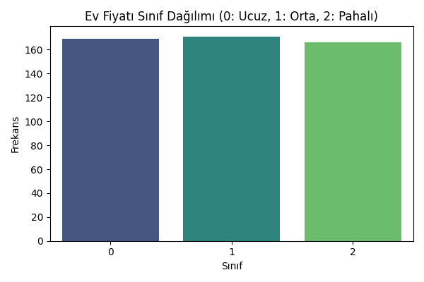
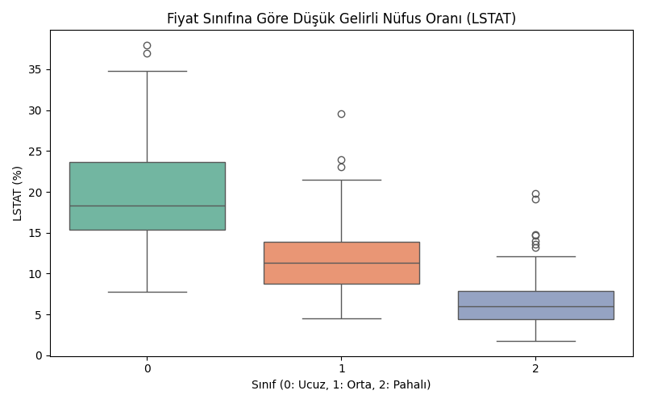
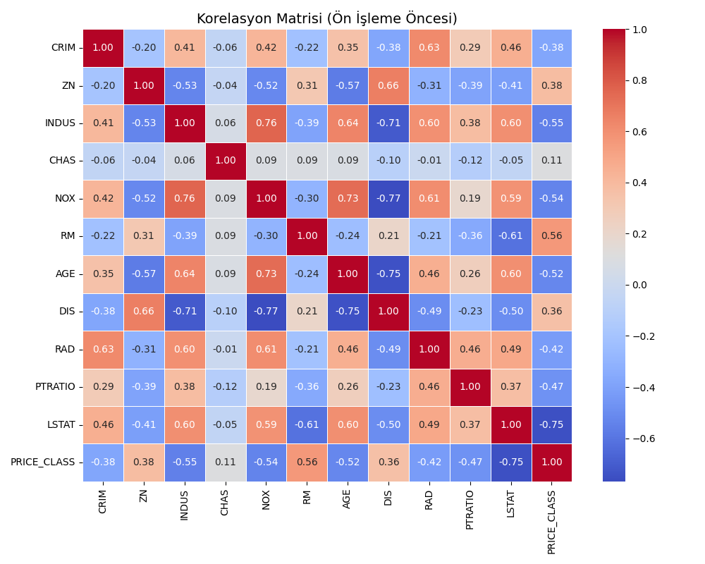
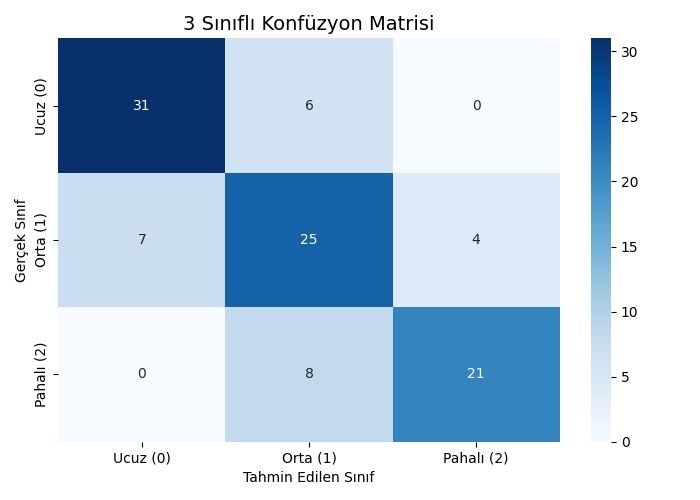

# Boston Konut Fiyatı Sınıflandırması (Ucuz / Orta / Pahalı)

Veri Madenciliğine Giriş dersi dönem sonu projesi. Boston Housing veri setindeki ev fiyatları (MEDV) üç eşit parçaya bölünerek **ucuz, orta ve pahalı** sınıflarına ayrıldı ve bu sınıflar **Random Forest** ile tahmin edildi.

## Yöntem
1. **Hedef değişken:** `MEDV`, `pd.qcut` ile eşit büyüklükte 3 sınıfa bölündü (0: Ucuz, 1: Orta, 2: Pahalı).
2. **Ön işleme:**
   - `B` ve `TAX` sütunları çıkarıldı. `B` sütunu ırksal bir değişken içerdiği için günümüzde etik açıdan sorunlu kabul ediliyor.
   - Özellikler `StandardScaler` ile standartlaştırıldı.
   - `SelectKBest (f_classif)` ile 11 özellikten en ayırt edici 7'si seçildi: **INDUS, NOX, RM, AGE, RAD, PTRATIO, LSTAT**.
3. **Model:** `RandomForestClassifier` (100 ağaç), 5 katlı çapraz doğrulama ile değerlendirildi.

## Sonuçlar (5 katlı çapraz doğrulama ortalaması)
| Metrik | Değer |
|---|---|
| Doğruluk (Accuracy) | %77,67 |
| Kesinlik (Precision, weighted) | %78,85 |
| Duyarlılık (Recall, weighted) | %77,67 |
| F1-Skoru (weighted) | %77,88 |

Katlara göre doğruluk: %74,51 · %79,21 · %82,18 · %73,27 · %79,21

## Görseller
| Sınıf dağılımı | Fiyat sınıfına göre LSTAT |
|---|---|
|  |  |

| Korelasyon matrisi | Karışıklık matrisi (test kümesi, %20) |
|---|---|
|  |  |

Model ucuz ve pahalı evleri birbirine hiç karıştırmıyor; hataların tamamı komşu sınıflar arasında, özellikle "orta" sınıfın sınırlarında.

## Çalıştırma
```bash
pip install -r requirements.txt
python boston_house_prices.py
```
Komut bu klasörün içinde çalıştırılmalı; grafikler aynı klasöre kaydedilir.

## Veri seti
Boston Housing veri seti (Harrison & Rubinfeld, 1978), 506 satır, 14 sütun. Makine öğrenmesi eğitiminde yaygın kullanılan, herkese açık bir veri setidir. `data/Boston-house-price-data.csv` dosyasında bulunur.
